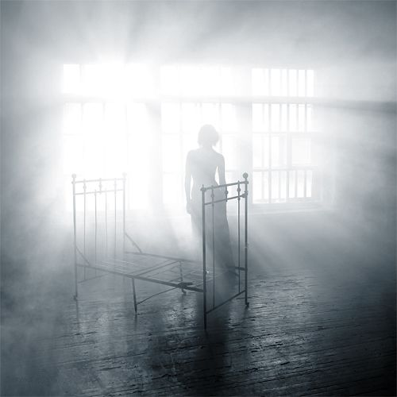

# Right to Hope...

快乐其实很简单，放下令你不快乐的人或事，怎么快乐，就选择怎样的方式活下去。做一个解决问题的人，而不是制造问题的人。  
  
  
世间太多的不快乐是因为过度的欲望，生理的物理的，欲念少一些，也可以令自己轻松快乐起来。面对欲望，各人能力不同，当明白自己真正要什么，什么适合自己，也许已是百转千回，上了年纪，不过总好过没有勇气选择，活在矛盾纠结中一辈子。乘人格没有彻底分裂前，让自己和周围的人都能活得简单，快乐。这总不是一种罪过吧？！  
  
  
  
  
  
虽然，事与愿违。  
但是，你一定要更快乐。

---

## 评论（9）

**Xiaona W.** · 2011-11-13

您说地很对，快乐是一种生活态度，它是可以选择的，不懂得放下，就很难做到彻底地快乐。

**frank** · 2011-11-13

谁不想衣食无忧，象八骑子弟一样提笼驾鸟，茶馆泡几个时辰， 可惜了了， 没这个命， 劳动人民赚的是辛苦钱， 店里没生意那个急， 我现在特能体会王掌柜。

**Mandy** · 2011-11-14

度过了劳累的一周，告诉自己只想活的简单点~~~其实生活就只是单纯的生活，你想它简单就简单，你想它复杂就复杂。

**caicai** · 2011-11-15

茶：博客写得越来越好，言语越来越睿智了也。赞一个。身边有些人就是喜欢制造问题，没事找事。我在想很大原因还是他们缺少美育。所以我想，吃喝玩乐、琴棋书画是多么滴重要，才会让人觉得生活的知足、有乐趣。

**Michelle** · 2011-11-15

在快乐与不快乐之间同样有很大的生存空间。如果不能达到高兴、幸福、或者满意的境界，可以在yes和no的中间地带选择较为沉静、平和，和充实的生活。

**joanna** · 2011-11-16

茶，这些话和感悟最近不只听一人说起，有些事真的到了这年纪才能体会。  
http://www.gold-finance.com.cn/news\_info.php?53 有机会去南京耍，俺们新的分公司在紫峰大厦。看上去比较山寨的那些照片是俺拍的，哈哈哈哈

**[Christina](http://lifetea.org)** · 2011-11-16

原来Joanna是做理财行业的啊~紫峰大厦应该是南京第一高楼了吧？！

**joanna** · 2011-11-16

跟客户定位相关，门脸儿总要做足。紫峰没去过，据说是的

**[jason](http://www.4utea.com)** · 2012-03-20

知足常乐！

