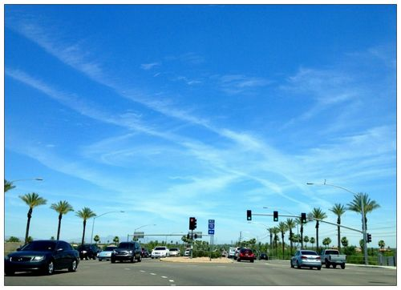
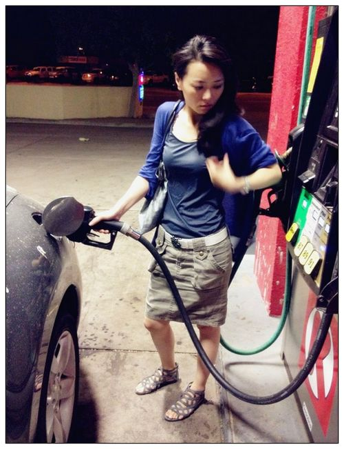
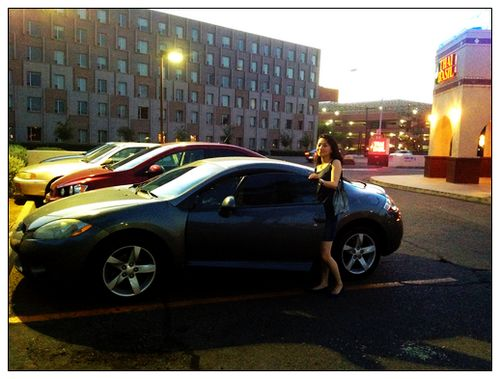

# @美国

六月二日到达美国，两周时间一直在倒时差，有史以来最长。  
  
  
一来就生病，扁桃体发炎，之后嗓子一直干疼，可能因为西南部气候原因，每天需要大量饮水。最最奢侈的是美国人几乎都喝瓶装水，两小时不到可以喝下五六瓶瓶装水。美国浪费的还有大排量汽车及空调的过度使用。美国在全球尽其所能的抢资源，国民生活习惯上资源浪费极大。  
  
  
我在美国第六大城市已经生活了三周，感受是“傻、大、土”，据说全美第二大富人区在此地，转过两趟，因为缺乏绿化和环境，再富的区域也黯然失色。在国内用于房子和汽车上的消费，到这里品质上能提高两三个层次。去当地的广东餐馆和中国超市几次，遇到一些出土级人物，整个世界都在前行，唯独将这些人留在了八十年代？这里一到晚上就是地狱，很多次晚饭后想出去散散步，出于安全考虑还是作罢。当地华人说，一般不出事，要是出事都是大事。带的单反相机一直没拿出来用，直接IPHONE了事。也许我对这里体会还不够多，印象也是浅显粗糙的，但喜好是个人的，这是最真实的反应。  
  
  
  
美国的天空真的很蓝。  
   
  
  
  
租了辆尼桑Altima S2.5，这款车路上跑的还挺多，第一次在美自助加油。上路前大致了解了下当地交通法规，开始有点儿紧张，后来开得多了也没什么问题。重点是这里永远是车让人，STOP标志一定要停留至少4秒。这与在国内驾车永远需要抢道的习惯相冲突，在国内永远有让不完的行人和车。  
  
  
  
租车前借朋友的车开了一周。  

---

## 评论（20）

**至清** · 2012-06-21

费城。沸城？废城？  
盼安。期待更多介绍。

**michelle** · 2012-06-22

暴露iphone也危险吧。外国小坏孩们特爱抢华人手中的apple产品。祝安。

**frank** · 2012-06-22

美国的特点就是按自己的意志生活， 没人care你生活在那个年代， 不用张扬不用自卑。

**lusfe** · 2012-06-23

扁桃体发炎，那得口服点抗生素，不过这是处方药了。

**ware** · 2012-06-23

好有型 喜欢

**小咬** · 2012-06-24

过起慢生活

**frank** · 2012-06-25

是呀， 岁数大了，移民很难适应美国的生活，现在不比2000年的时候， 绿卡工作都比较容易， 不过， 你还有机会外嫁，这可能是唯一的捷径， 90年代末2000年初来美的人混的都不错，一年二十万应该比较平常了。

**Mavis** · 2012-06-26

好久不见茶更博，猜是很忙吧，祝你开开心心适应美国生活，希望能经常见到你的新照哈~~

**[4utea](http://www.promstreet.com)** · 2012-06-27

美国，想得美

**Mandy** · 2012-07-10

费城？你去美国了~~旅游？好久没有看见你的更新还一直挂念~~~祝好！

**[standme](http://www.standme.com)** · 2012-07-10

去年的时候去了洛杉矶，在那边跑了一周，可惜时间太短，而且我也是为了我的签证不过期，在签证有效期内去一次，害怕如果签过了没去的话以后会被拒签。你说的“傻、大、土”，貌似我也没有太多感受，我的感受就是，地地道道的实用主义，没有文化底蕴，一切以实用为主，日本的汽车便宜、省油，所以现在街上跑的日本车多了，怪不得美国人要干丰田，其实坏着呢。

**frank** · 2012-07-11

日本车在美国不便宜， 比如acura, Lexus, infinit, 我现在有bmw x5 和 acura mdx, 差不多时间买的x5已经修理三四次， mdx一次没修过，美国上班工作很紧，最怕修车，日本车比较reliable.

**[宁波物流公司](http://www.nbdc56.com)** · 2012-07-15

博客不错，很用心的博主，关注与学习中！谢谢

**seawolf4673** · 2012-07-30

不回来了么？

**雯子** · 2012-08-01

茶，最近更新很慢哦！天气热去避暑了哇！

**[standme](http://www.standme.com)** · 2012-08-02

回复 frank：  
我说日本车便宜，主要是指丰田、本田之流，而不是他们的高端品牌啊

**[宁波物流公司](http://www.nbdc56.com)** · 2012-08-08

博主的博客很精彩，风格很喜欢，支持一个！

**IT guy** · 2012-08-13

更新不勤啊，问christina好。

**[宁波钢琴](http://www.china-forlove.com)** · 2012-08-20

博客风格不错，学习了！

**Theresa** · 2012-08-29

哪里说是费城? 看着不像啊. 费城大着呢,要看哪里了. 市中心二十街以前是好地方, 安全的很.

