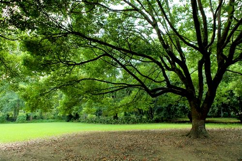
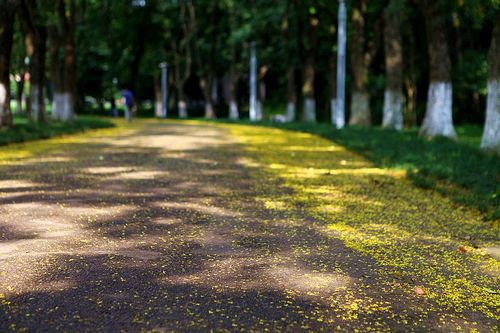
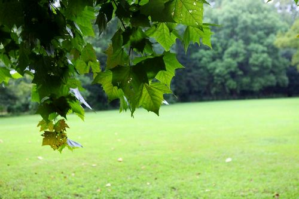
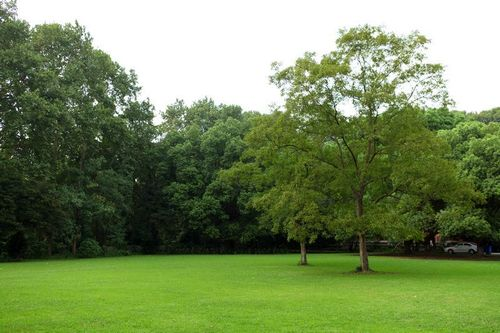
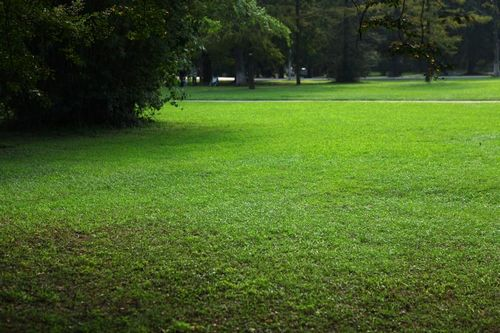
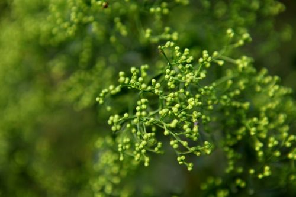
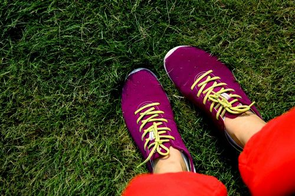
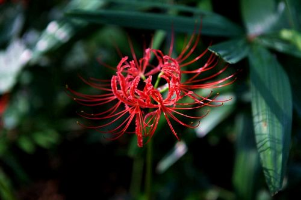
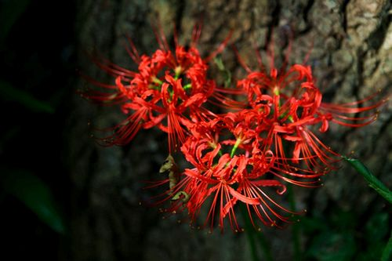

# 人间好时节

春有百花秋有月，  
夏有凉风冬有雪，  
若无闲事挂心头，  
便是人间好时节。  
*-- 宋·无门和尚《颂》*  
  
   
   
   
   
   
   
   
  
  
\*彼岸花\*  
   

---

## 评论（5）

**大姜炖去** · 2012-09-09

确是人间好时节啊，绿的沁人，红的灿烂  
头两句让我想起前几天芒果台的非常靠谱的一期节目，里面把春夏秋冬花月风雪这几个稀罕姓氏的人请来，还挺有意思的

**frank** · 2012-09-18

一片绿没有色彩， 秋天可以看红叶， 在美国你出去旅游，到处走走，你会喜欢的。

**雯子** · 2012-09-26

第四张那片绿色，好喜欢啊。

**favsttiger** · 2012-09-27

最好将图片上传到网上，百度相册不错 ，看见不错的话可以拿来当壁纸，可惜南方没有雪。

**iceshine** · 2012-10-27

人生若只如初见~

