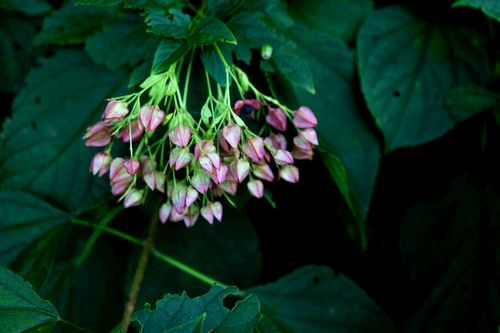
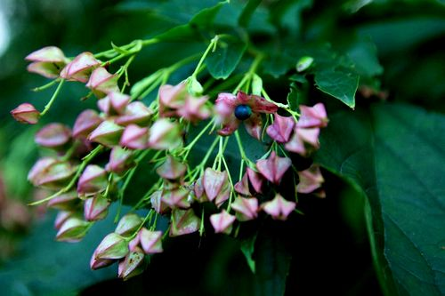
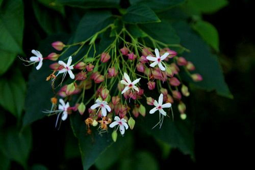
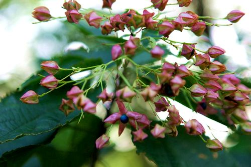

# 情义。

如果只有一样东西死后可以带走，我只要情义。  
  
   
   
   

---

## 评论（8）

**大姜炖去** · 2012-10-14

可惜大多数时候情义也像这花一样昼开夜休生存死殁，活的时候有情就好

**[至清](http://blog.qinmo.net)** · 2012-10-15

如果只有一样东西死后必须留下，我只留情义。

**iceshine** · 2012-10-17

someone like you

**frank** · 2012-10-19

亲情最重要

**GU** · 2012-10-29

姐姐，我很喜欢的你博客。只是发现最近更新少了，写微博去了吗？

**[jimmyzou](http://roovenzou.com)** · 2012-11-17

很久没来过了，最近都好么

**[standme](http://www.standme.com)** · 2012-11-25

貌似你的程序该更新了，不然没办法阻挡垃圾评论了，呵呵。

**Maggie** · 2012-12-13

好久没看到你的摄影作品啦~

