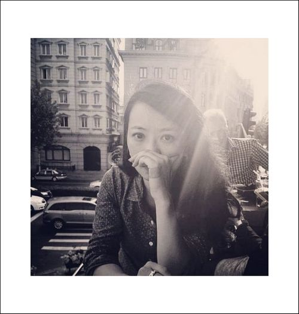

# 一个人的旅行

一个人在家，空气清冷，毕竟冬天到了。这样也好，安静下来可以写点什么。  
  
  
11月中旬辞职，之前一直病休，自去年年底开始几乎每天迟到，颈椎的问题，睡眠的问题，焦虑的问题。陆续请病假，领导说要不你先病休半年吧。期间，婉拒公司提供的各种新岗位，希望就这么病休下去。半年后权衡各种状况，我选择了辞职。这期间，生活也发生了很大的转变，纠结有过，后悔有过，彷徨有过，失落有过...有关辞职，好多年前我曾无数遍地在心里演示过，我以为我会满心欢喜地离开公司，然后回头痛斥公司的种种不是，可是最终公司对待我的态度让我心存感激，还有一些人情味。  
  
  
看到朋友转载的文字：“荣格非常重视人的后半生（中年之后)，他认为这是人类走向个体化的重要时期。中年之前，人们只是一味地追求与现实世界的联系，往往无暇顾及自己的内心世界，在生活中完全受自我支配。当社会地位、工作、生活和梦想到达一定程度的稳定时，人们就会开始思考人生的意义。这就是中年时期。”  
  
  
中年也可以任性地活一次吧？短短人生数十载，时间“嗖”的一下就没了。算计着过，虚伪地过，谦卑着过，按部就班地过，循规蹈矩地过，任性也是一种过法。我爱现在的自己，甚于爱青春期的我。就让旅行开始吧。  
  
  

---

## 评论（38）

**watsondream** · 2012-12-07

祝福身体好些!

**wingalin139** · 2012-12-07

茶,要注意身体啊

**[年华似水](http://dearos1943@hotmail.com)** · 2012-12-07

十年前…  
十年后…  
还是只有默默祝福！

**Tintin** · 2012-12-07

岁月静好，美丽如初。愿你一路平安、喜乐。

**[jiajia](http://www.imiss.me/otr/)** · 2012-12-07

我也是十月初辞职，之前彷徨很久，但一旦下定决心整个人都轻松了。也是一个人旅行，上路之后认识许多人，听他们的故事，越发觉得自己真是幸运。在还算年轻的时候走上旅途，重新认识自己，并不是每个人有这样的能力和勇气。祝好：）

**Frank** · 2012-12-07

美女，打算去那里玩？我也打算出游，你是一个很好的驴友，约几个朋友非洲徒步自驾，车从美国运过去， 二手Ford f150.

**Fei** · 2012-12-08

If you ever travel to Switzerland, please let me know – I might be able to give you some hints and show you around.

Take care and all the best…

**Frank** · 2012-12-08

美女想不想开个网店，我和whole sale 有合同，能拿到比retail 低20%的价，维生素，营养品，5／5分成。

**andemen** · 2012-12-08

欣赏、祝福

**大姜炖去** · 2012-12-08

让旅程开始吧  
Let the journey begin!

**Chrisitna** · 2012-12-08

谢谢各位的关照和祝福，希望大家都能找到适合自己的生活。

**shanshu** · 2012-12-09

祝顺利。我今年也是身体断续的出问题，工作上也变数很大。真要做到宠辱不惊也不是件容易的事情。感觉自己已经处在上有老下有小的压力期。

**mandy** · 2012-12-10

无论你做什么选择只要快乐就好。羡慕你，因为自己也想任性过一次。祝一切都好！

**seawolf4673** · 2012-12-10

荣格的话很有道理

**雯子** · 2012-12-10

做自己喜欢做的事，很需要勇气啊。佩服茶美女。祝一切都好！

**[gaoguangguang](http://gaoguangguang.blogbus.com)** · 2012-12-11

上次你问到圣诞的时候我是否在美国，我会在北京。如果明年2月以后你到美国就来找我吧。祝你旅途愉快！

**ILN** · 2012-12-12

Frank, what an idol and a Red-neck are you! F-150 is all you can come up in your head for travelling in Africa? Do you have any f\*\*\*ing idea what types of people drive Ford F150 in US? You think there is a Hilton or Marriott every 50 mile or so across the Africa continent? What happens if the lady needs to go to restroom? Are you going to let her do it in the open air while the dust is blowing all around?  
So next time before you open your big fat mouth spitting sh\*t around, consult with your family 1st to see if anything you sh\*t here made any sense?

**QYH** · 2012-12-12

Please ignore those idiots. BTW, what happened to your hand?

**Maggie** · 2012-12-13

等看围脖,跟着你旅行~

**waterqian** · 2012-12-13

如果身体有问题的话，要看病的。平时可以多多静坐。可以预防一些病的

**Agnes** · 2012-12-14

茶，看到你的更新好高兴！本来以为就此和你擦肩而过了呢。。。作为同龄人，理解你的感受和选择。很感谢你这么多年跟我们分享你的多彩人生，看你的博客，让我真真地感受生活到了的精致和美好。愿一切安好，继续尽情享受生活。。。

**5K** · 2012-12-15

从05年初关注你的博客到现在，这个冬天很冷，自己也发生了很多变故，感情，工作。  
人生充满喜怒哀乐，还是做自己想做的事情，调整好吧。  
祝一切安好。

**weeli** · 2012-12-19

这么多年一直看你的博客，又追至微博，若条件允许改变生活方式，放弃按部就班的生活，我觉得你的选择很棒，也默默祝福你一切顺利。虽然我目前还没有选择任性生活的条件，但相信有一天能有，现在只能在心底里设想一下以后辞职时的潇洒吧：）

**Theresa** · 2012-12-20

一直惦记着茶, 佩服你选择的勇气, 我们大多数人只能按部就班的生活着. 荣格的话非常现实.

**Theresa** · 2012-12-21

谁能指点一下茶的微博,找不到啊!!

**Edward** · 2012-12-21

Welcome to Australia.

**Agnes** · 2012-12-21

是啊，很想关注茶的微博，知道的分享一下啦，谢谢！

**[sherry](http://hisherry.com)** · 2012-12-27

不知道旅行到哪里了？祝顺利！

**vicky** · 2013-01-03

赞！尊崇内心，做真实的自己：）

**[i_mu](http://11)** · 2013-01-04

开心最重要，保重身体。还记得我到集团上班，你为我送行那的顿饭，一直心存感激啊。

**[涉水轻舟](http://sheshui.me)** · 2013-01-07

每次离职或许都是一次艰难的决定，却也是一直艰难的开始… 祝好！ 同是 Textpattern 用户…

**长妮儿** · 2013-01-11

加油！祝福~~

**dongdong** · 2013-01-29

作为默默关注的人，希望你健康 快乐！

**珂杰** · 2013-02-01

默默关注了很多年，喜欢茶的清新与优雅。今天看见茶的新旅程，真心感动，希望茶一切都好，希望茶更精彩与更美丽。我会继续跟着茶感悟斑斓的人生色彩。茶，加油！自己更要加油！

**乔西西** · 2013-02-04

很久没来，变化好大。望一切安好

**[养猫人](http://meogqy.com)** · 2013-03-31

这个博客也是wordpress程序？

妹子不会也是搞IT的吧~

**Brad** · 2013-03-31

人生就像一场旅行，不必在乎目的地，在乎的是沿途的风景以及看风景的心情！

**细菌** · 2013-04-01

荣格，格式塔心理学创始人。了不得。不过那段关于荣格的话有些片面。其中暗示人只在中年及在某种自我满足之后才会反思。其中两点都指向人的心态变化。而这种变化在生命的任何转折点都可能发生，包括健康，家庭，婚姻，失业和其它方面的失败，及重大事故。就是说，人在任何年龄阶段或者任何经济状况下都可能对“人生的意义”反省。

