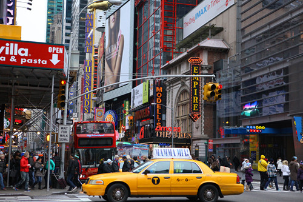
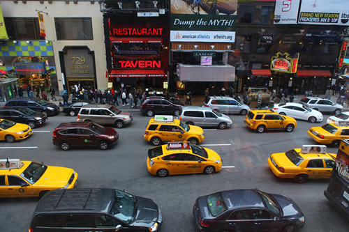

# 有谁是真正的纽约客？

   
   
  
  
这座无数次作为美国都市影视剧作品背景的城市，在圣诞节前后塞满了来自世界各地的游客，我那一点点旅行者的热情也被无情的风雪完全浇灭了。到了这儿才知道，这里没有谁是真正的纽约客，多元文化相融合的城市，有北京和上海的影子。  
  
  
又是辞旧迎新之际，忽生厌恶之情，厌恶一切有界限的东西，但却无法拒绝，这是矛盾之处。厌恶了在这个时候大家都说些祝福的话。厌恶终点或起点的归纳。

---

## 评论（5）

**waterqian** · 2013-01-04

这个世界，我们能够怎样？又能怎样呢？一切随缘，随心吧了。开心就好。

**fs-kitty** · 2013-01-07

久不见，有点变化，好的。小女子最大的愿望是退休，然后旅行，羡慕你呀！  
TAKE CARE!

**至清** · 2013-01-23

厌恶终点或起点的归纳。我也是。

**mandy** · 2013-01-24

看着窗外我没有任何新年前的放松和愉悦，心里只是莫名的厌烦~~我还羡慕你能出去走走，旅行也许是最好的解脱

**yyvickie** · 2013-02-18

能在纽约生存下来的就是真正的纽约客。能告知下微博帐号吗，看看近况。

