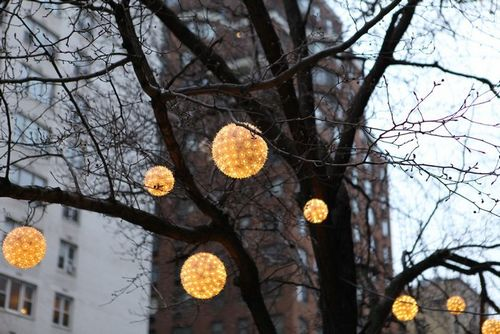
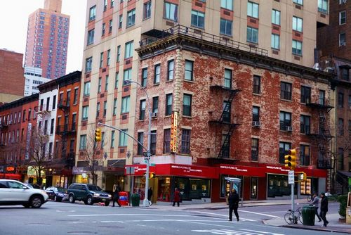
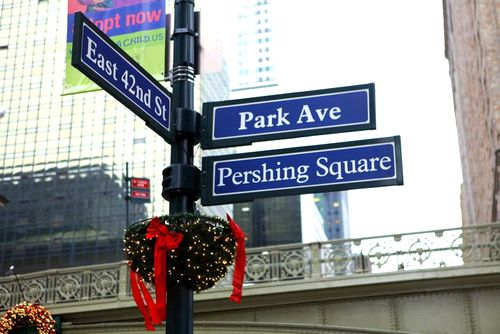
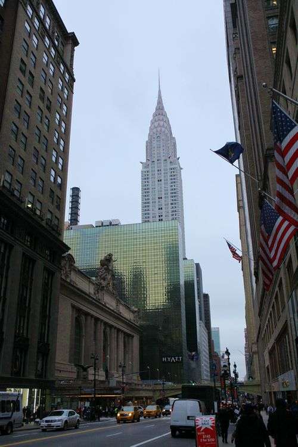

# NYC

住在纽约曼哈顿midtown第42街中国驻纽约领事馆，每天早晨那些个做体操拉横幅的大妈大婶们准点来门前报到。12月底的纽约风力很大，异常寒冷，流感肆虐，此后感冒，接连咳嗽三个多星期才好。对于很多人而言，midtown（中城）就是纽约，因为这儿有第五大道，时代广场，中央公园，卡内基音乐厅。第六大道上是各大公司的总部，正因如此，这儿的消费也都是天价，餐厅、商店的价格都极致地发挥了资本主义。  
   
   
   
   
  
纽约Grand Central Terminal（中央车站），从1913年沿用至今的古建筑，每天进出550列车，50万乘客通过这里往返于纽约上州（up state）沿线城镇。曼哈顿的房价非常昂贵，一些人会在郊外甚至到新泽西州买房子，上下班乘火车，花在路上1-2小时属正常。  

---

## 评论（8）

**mandy** · 2013-01-28

又看见你的笑脸~~祝好！有点想念你的两只可爱的狗狗，它们好吗？

**qd** · 2013-01-28

在异国很少更新呀。等得着急人。。

**Chrisitna** · 2013-01-28

好，都好~

**Edward** · 2013-01-31

领事馆也能住？

**yyvickie** · 2013-02-06

漂亮依旧。

**乔西西** · 2013-05-02

时不时来看看

**Jimmy** · 2013-05-04

怎么去纽约了? 离我这个小镇不远

**zzz** · 2013-05-05

好久没更新了 :(

