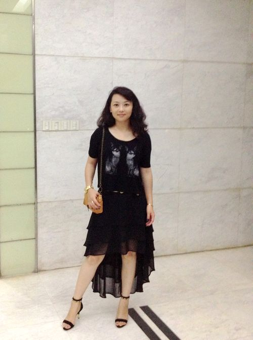

# TO ALL...

8月中旬看了孟京辉的话剧《活着》，最初是在《收获》杂志上看到余华的小说，之后看过电影，很好奇这么沉重严肃的小说如何导成话剧？七月一日在网上预订话剧票，发现全部售罄。。。上海的消费能力真是了得，文化消费也如此厉害，所幸托人买到了。朋友说在北京见过他夫人廖一梅，说生活中不会喜欢这样的女人。有时，才华和人品是两回事？！  
  
上海艺海剧院对面卖苏州汤包的小店，生意火爆，进剧院前在那里解决的晚饭，里面乌泱泱都是人。剧院的停车场已经没有位置，车停在对面大厦的地下车库，离开时付了40元的停车费，想起南京大商场地下车库还有2.5的停车费。。。这就是上海。  
  
之前看过黄渤的《疯狂的石头》、《人在囧途之泰囧》、《厨子痞子戏子》，还是看过这部话剧之后对他渐生好感。虽然有人说他演的不如葛优，可我就是喜欢他这种匪气十足的调调。袁泉在舞台上好瘦小，声音很有魅力，表演细腻，不过因为身形过瘦，肢体语言欠丰满。我没有戴相机，因为场内不允许拍照，表演中没有人打手机、手机铃声响起或人声嘈杂的现象，总体素养挺好。  
  
最后，在我过去的生日那天，送给我至亲至爱的人们：“我要在你平庸无奇的回忆里，做一个闪闪发光的神经病。”  
  

---

## 评论（14）

**guangguang** · 2013-08-26

沙发

**KA KA LEE** · 2013-08-27

你又回来了，我很开心，关注你的文字和图片6年有余

**[root](http://cutesunshineriver.iteye.com)** · 2013-08-28

怪不得说我眼前一亮，原来你回来了。

**Kevin** · 2013-08-30

美 :)

**Allen** · 2013-09-01

You are so detail focused. Very polished dressing. I like.  
Happy b day!

**[caomuqingqing](http://·)** · 2013-09-09

好久没看茶妹妹的博了，还是那么美，喜欢！请问茶有微博或微信吗？

**[abidingstar](http://无)** · 2013-09-17

关注你的博客有8年了，喜欢经常来你这儿转转。

**dong** · 2013-09-18

我是去看的是最后一场，由于买的380那种很便宜的票，坐的位置距离舞台八丈远，黄渤的脸都模糊不清，但还是看的很high，观众的素质确实不错，黄渤身上的那种调调还是很喜欢的。

**Christina** · 2013-09-20

：）

**网友甲** · 2013-09-24

还休息着吗？ 我现在钱用光了，不得不回来上班。

**东西南北中** · 2013-10-01

Hey, 请继续你的你的坚持，请继续让我看到你的文字吧…

**christina** · 2013-10-19

会的，感谢关爱！

**[Rocky](http://rocky.im)** · 2013-12-06

博主很美~话说我搜索的是china tea，搜到了博主的网站……

**Qiaoo** · 2013-12-07

微博是什么，想关注

